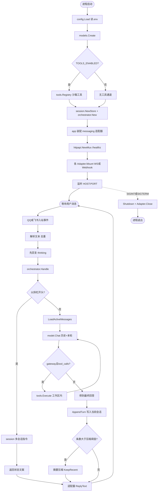
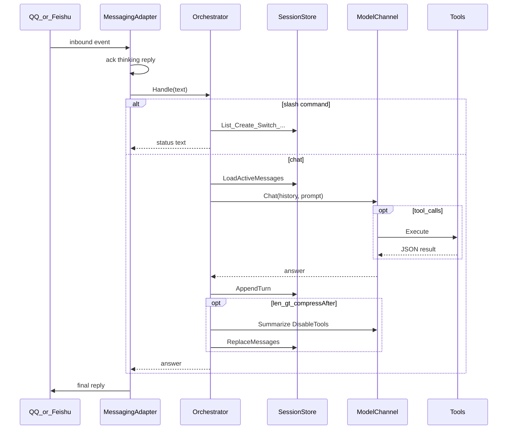

# 模块说明

本文描述 Personal Bot（Go 主运行时）各包职责、关键类型、数据流与配置边界。快速上手见根目录 [README.md](../README.md)。

## 1. 总体架构

### 1.1 总体流程图

从进程启动到一问一答的端到端流程：



### 1.2 模块依赖关系

```
┌─────────────┐   ┌──────────────┐
│ messaging/* │   │ models/*     │
│ qq/feishu   │   │ gateway/codex│
└──────┬──────┘   └──────▲───────┘
       │                 │
       ▼                 │
┌──────────────┐   ┌─────┴──────┐
│ orchestrator │──▶│ session    │
└──────────────┘   └────────────┘
       ▲
       │ Mount / HTTP
┌──────┴───────┐   ┌────────────┐
│ cmd + httpapi│   │ tools/*    │◀── gateway tools loop
│ app (装配)   │   └────────────┘
└──────────────┘
```

启动顺序（[`cmd/personal-bot/main.go`](../cmd/personal-bot/main.go)）：

1. `config.Load()` 读 `.env`
2. `models.Create` 建模型通道（可选挂上 `tools.Registry`）
3. `session.NewStore` + `orchestrator.New`
4. `app.CreateMessagingAdapters` → `httpapi.NewMux` → 各适配器 `Mount`
5. 监听 `HOST:PORT`，优雅关闭时 `Shutdown` + `Adapter.Close`

平台无关的入站统一为 `orchestrator.IncomingUserMessage`；出站由各 messaging 适配器自行 `ReplyText`。

---

## 2. `cmd/personal-bot`

进程入口。不业务逻辑，只装配依赖、打 boot 日志、跑 HTTP 与信号处理。

| 步骤 | 说明 |
|------|------|
| 配置失败 / 模型失败 / Mount 失败 | `log.Fatalf` 退出 |
| HTTP | `http.Server` + `/healthz` 及适配器注册的 webhook |
| 信号 | `SIGINT` / `SIGTERM` → 10s 超时 Shutdown |

---

## 3. `internal/config`

环境变量加载与校验。依赖 `godotenv`，优先进程环境，`.env` 作本地默认。

**主要字段分组：**

| 组 | 关键变量 |
|----|----------|
| 服务 | `HOST` `PORT` |
| 消息 | `MESSAGING_CHANNELS`（逗号分隔）、飞书 / QQ 凭证与 `QQ_TRANSPORT` |
| 模型 | `MODEL_CHANNEL`、`GATEWAY_*`、`CODEX_*` |
| 会话 | `SESSION_TTL_HOURS`、`SESSION_COMPRESS_AFTER`、`SESSION_KEEP_RECENT` |
| 人设 | `BOT_SYSTEM_PROMPT` |
| 工具 | `TOOLS_*`、`TOOL_WORKSPACE`（解析为绝对路径） |

**校验：** 启用的平台必须带齐凭证；`gateway_api` 必须有 `GATEWAY_API_KEY`；未知枚举值直接报错。

类型别名：`MessagingPlatform`、`ModelChannel`、`QQTransport`。

---

## 4. `internal/app`

消息适配器工厂，避免 `main` 直接依赖各平台包产生循环引用。

- `CreateMessagingAdapters(ids)` → `[]messaging.Adapter`
- `ReadyMessagingPlatforms()` → 当前实现完备的平台（`qq`、`feishu`；`wechat` 不在此列）

---

## 5. `internal/httpapi`

创建根 `ServeMux`，注册通用路由。适配器可在 `Mount` 时往同一 mux 挂 webhook。

**`GET /healthz` JSON：**

- `ok`、`runtime: go`
- `messaging.enabled` / `messaging.ready`
- `model.active` / `model.available`

---

## 6. `internal/messaging`

### 6.1 接口（`types.go`）

```go
type Adapter interface {
    ID() config.MessagingPlatform
    Mount(ctx AdapterContext) error  // 注册 HTTP 和/或长连接
    Close() error
}

type AdapterContext struct {
    Config, Orchestrator, Mux
}
```

### 6.2 `messaging/qq`

QQ 开放平台机器人。

| 文件 | 职责 |
|------|------|
| `adapter.go` | 按 `QQ_TRANSPORT` 启 WS / Webhook / both |
| `ws.go` | 网关 WebSocket：Hello、Identify、心跳、Resume、事件分发 |
| `webhook.go` | HTTP 回调 + Ed25519 验签；挑战响应 |
| `crypto.go` | 签名校验 |
| `client.go` | 调 QQ HTTP API（access_token、回复群/C2C） |
| `handler.go` | 解析入站、去重、先回「thinking」、再调 Orchestrator |

**事件：** `GROUP_AT_MESSAGE_CREATE`（群 @）、`C2C_MESSAGE_CREATE`（私聊）。  
**去重：** 进程内 `messageID` 集合，上限约 5000 条轮换删除。  
**文本：** `cleanText` 去掉 mention 噪声。

### 6.3 `messaging/feishu`

飞书事件订阅 Webhook：解密/校验、抽文本（去 @）、回复。逻辑与 QQ handler 对称，最终都进 `orch.Handle`。

### 6.4 `messaging/wechat`

占位。`Mount` 返回明确未实现错误，便于配置写错时立刻失败。

---

## 7. `internal/orchestrator`

平台无关编排层：会话指令 + 对话 + 压缩触发。

**入站：** `IncomingUserMessage{Platform, ChatID, UserID, MessageID, Text}`

**`Handle` 流程：**

1. `session.BuildKey(platform, chat, user)` 得到 owner key  
2. 若文本以 `/` 开头 → 斜杠指令，直接返回中文状态，**不调模型**  
3. 否则 `LoadActiveMessages` → `model.Chat(Messages + Prompt)`  
4. `AppendTurn`；若条数 `> CompressAfter` → `MaybeCompress`（无 tool 摘要）

**斜杠指令：** `/help` `/list` `/new [标题]` `/use N` `/rename 标题` `/clear`

**压缩 Summarizer：** 包内 `modelSummarizer`，对旧消息调用 `Chat(..., DisableTools: true)`。

---

## 8. `internal/session`

多会话与上下文的**唯一真相源**（模型通道不再自存 history）。

### 8.1 数据结构（`store.go`）

- Owner key：`platform:chatID:userID`
- 每个 owner：`ActiveID` + 最多 **10** 个 `Conversation`
- 每个会话：`ID`（`cN`）、`Title`、`UpdatedAt`、`Messages[]{Role, Content}`
- TTL：按 owner 最后活跃时间；超时整袋删除
- 首次访问自动建「默认会话」

**API：** `List` / `Create` / `Switch` / `Rename` / `ClearActive` / `LoadActiveMessages` / `AppendTurn` / `ReplaceMessages` / `EnsureActive`

### 8.2 压缩（`compress.go`）

当 `len(messages) > compressAfter`（默认 30）：

1. `old = 前面部分`，`keep = 最近 keepRecent`（默认 16）
2. `Summarizer.Summarize(old)` → 一条 `role=system` 的 `[对话摘要]…`
3. 失败则硬截断到 `keep`，打日志

内存存储，**进程重启丢失**。

---

## 9. `internal/models`

可插拔模型后端。

### 9.1 契约（`types.go`）

```go
type Channel interface {
    ID() config.ModelChannel
    Chat(req Request) (Response, error)
}

type Request struct {
    SessionKey, ConversationID string
    Messages []ChatMessage   // 历史（含摘要），不含本轮 user
    Prompt   string          // 本轮用户输入
    DisableTools bool        // 压缩摘要时关闭 tools
}
```

### 9.2 `registry.go` → `Create`

| `MODEL_CHANNEL` | 行为 |
|-----------------|------|
| `gateway_api` | 可选构建 `tools.Registry`，返回 gateway 通道 |
| `codex_local` | 本机 `codex exec`，无 OpenAI tools 循环 |

### 9.3 `gateway.go`

OpenAI 兼容 `POST {base}/chat/completions`：

1. 拼 `system`（人设 + 工具说明）+ `req.Messages` + 本轮 `user`
2. 若启用 tools：多轮 `tool_calls` → `tools.Execute`，上限 `TOOL_MAX_ROUNDS`
3. `DisableTools` 时单轮、不带 tools
4. **不写**会话历史；由 orchestrator/session 负责

### 9.4 `codex.go`

把人设 + 历史 + 本轮用户拼成一段 prompt，执行 `codex exec --skip-git-repo-check`，工作目录 `CODEX_WORKING_DIRECTORY`，超时 10 分钟。同样无状态。

---

## 10. `internal/tools`

仅 `gateway_api` 在 tools 开启时使用。所有路径解析经 `Workspace`，禁止逃出根目录。

| 组件 | 说明 |
|------|------|
| `types.go` | `Tool` 接口；转 OpenAI `tools[]` |
| `registry.go` | 注册表、`Execute`、`OpenAITools` |
| `workspace.go` | 绝对根路径 + `Resolve` 沙箱 |
| `fs.go` | `read_file` / `write_file` / `list_dir` |
| `shell.go` | `run_command`：超时、输出字节上限、cwd=workspace |

**配置：** `TOOLS_ENABLED`、`TOOL_WORKSPACE`、`TOOL_COMMAND_TIMEOUT_SEC`、`TOOL_MAX_ROUNDS`、`TOOL_MAX_OUTPUT_BYTES`。

---

## 11. `legacy/node`

历史 Node/TypeScript 实现，**不再作为主运行时**。新功能只合入 Go 树。迁移对照可参阅该目录内 README。

---

## 12. 请求生命周期（正常对话）



---

## 13. 扩展指引（简表）

| 想做 | 改哪里 |
|------|--------|
| 新消息平台 | 实现 `messaging.Adapter`，在 `app.createMessagingAdapter` 注册 |
| 新模型后端 | 实现 `models.Channel`，在 `models.Create` / `List` 注册 |
| 新工具 | 实现 `tools.Tool`，在 `NewRegistry` 里 `Register` |
| 改会话策略 | `session` + orchestrator 指令解析；阈值用 env |
| 新 HTTP 探针 | `httpapi.NewMux` |

---

## 14. 相关文件索引

| 路径 | 一句话 |
|------|--------|
| [`cmd/personal-bot/main.go`](../cmd/personal-bot/main.go) | 启动与关闭 |
| [`internal/config/config.go`](../internal/config/config.go) | 配置 |
| [`internal/orchestrator/orchestrator.go`](../internal/orchestrator/orchestrator.go) | 编排与指令 |
| [`internal/session/store.go`](../internal/session/store.go) | 多会话存储 |
| [`internal/session/compress.go`](../internal/session/compress.go) | 上下文压缩 |
| [`internal/models/gateway.go`](../internal/models/gateway.go) | 网关对话 + tools |
| [`internal/models/codex.go`](../internal/models/codex.go) | Codex CLI |
| [`internal/tools/`](../internal/tools/) | 工作区沙箱工具 |
| [`internal/messaging/qq/`](../internal/messaging/qq/) | QQ WS/Webhook |
| [`internal/messaging/feishu/`](../internal/messaging/feishu/) | 飞书 Webhook |
| [`.env.example`](../.env.example) | 配置模板 |
