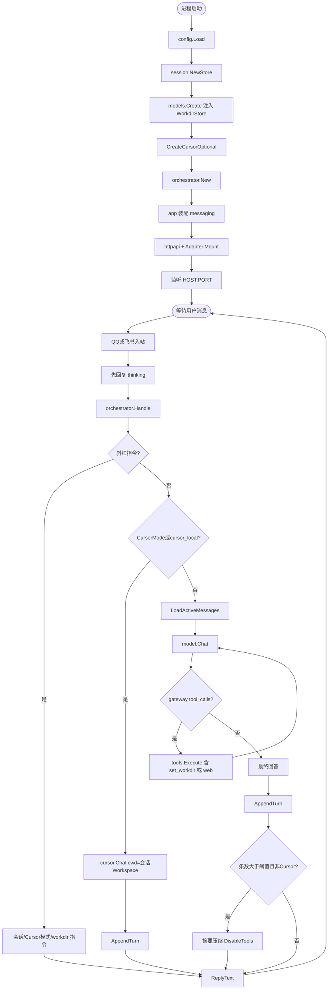
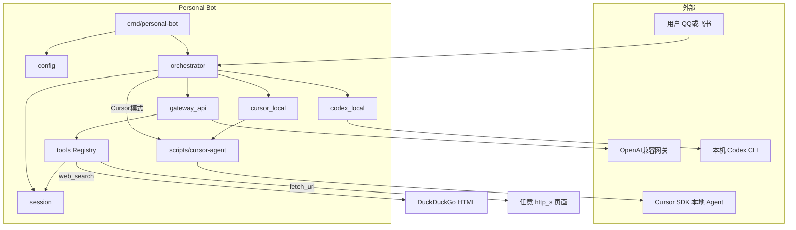
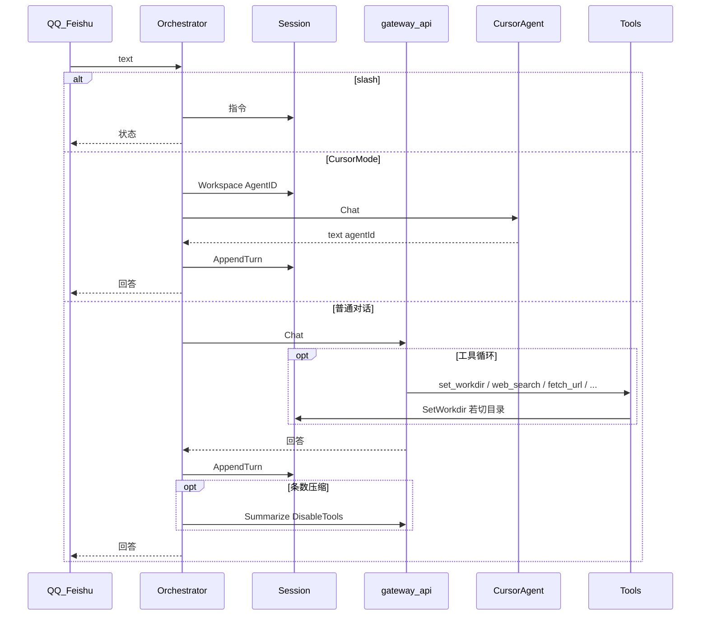

# 模块说明

本文描述 Personal Bot（Go 主运行时）各包职责、关键类型、数据流与配置边界。快速上手见根目录 [README.md](../README.md)。

## 1. 总体架构

### 1.1 总体流程图

从进程启动到一问一答：



### 1.2 框架图



### 1.3 模块依赖（简图）

```
messaging/* ──► orchestrator ──► session
                     │
                     ├── models (gateway / codex / cursor)
                     └── tools ◄── gateway（SessionKey 经 context）
scripts/cursor-agent ◄── cursor_local 与 /cursor 模式
```

启动顺序：`config` → `session.NewStore` → `models.Create(cfg, sessions)` → `CreateCursorOptional` → `orchestrator.New` → messaging `Mount` → listen。

---

## 2. `cmd/personal-bot`

进程入口：装配依赖、boot 日志、HTTP、信号优雅退出。  
`sessions` 同时作为 `tools.WorkdirStore` 注入 gateway 工具，使 `set_workdir` 与 `/cursor` 共用同一会话目录。

---

## 3. `internal/config`

| 组 | 变量 |
|----|------|
| 服务 | `HOST` `PORT` |
| 消息 | `MESSAGING_CHANNELS`、飞书 / QQ 凭证、`QQ_TRANSPORT` |
| 模型 | `MODEL_CHANNEL`、`GATEWAY_*`、`CODEX_*`、`CURSOR_*` |
| 会话 | `SESSION_TTL_HOURS`、`SESSION_COMPRESS_AFTER`、`SESSION_KEEP_RECENT` |
| 工具 | `TOOLS_ENABLED`、`WEB_TOOLS_ENABLED`、`TOOL_WORKSPACE`、`TOOL_COMMAND_TIMEOUT_SEC`、`TOOL_HTTP_TIMEOUT_SEC`、`TOOL_MAX_ROUNDS`、`TOOL_MAX_OUTPUT_BYTES` |

全部环境变量在启动时由 `config.Load()` 读入内存（通常来自 `.env`），**运行中不热更新**；改完需重启进程。  
`TOOL_WORKSPACE` 仅为默认起点，不是路径监狱。`cursor_local` 与 `/cursor` 模式都需要 `CURSOR_API_KEY`（后者经 `CreateCursorOptional`）。

---

## 4. `internal/app`

消息适配器工厂：`qq` / `feishu` / `wechat`（占位）。

---

## 5. `internal/httpapi`

`GET /healthz`：messaging / model / runtime 状态。适配器可往同一 mux 挂 webhook。

---

## 6. `internal/messaging`

`Adapter`：`Mount` / `Close`。入站统一为 `orchestrator.IncomingUserMessage`。

- **qq**：WS / Webhook + Ed25519；群 @ / C2C；先回 thinking。
- **feishu**：Webhook 解密校验与回复。
- **wechat**：占位，Mount 报错。

---

## 7. `internal/orchestrator`

**`Handle`：**

1. 斜杠指令 → 状态文案（一般不调模型）
2. 若 `CursorMode` 或主通道为 `cursor_local` → `chatWithCursor`（Cursor SDK，不用 Go tools）
3. 否则主通道 `model.Chat`；`gateway_api` 在 `TOOLS_ENABLED` 下挂全部已注册工具，`tool_choice=auto` 由模型按需调用
4. 条数超阈值则压缩（Cursor 路径不做条数压缩）；压缩摘要请求带 `DisableTools: true`

**Cursor 模式：**

| 指令 | 行为 |
|------|------|
| `/cursor` | 进入模式；之后普通消息走 Cursor |
| `/cursor exit` | 退出，回到主通道 |
| `/cursor status` | 查看状态 |
| `/cursor 路径` | 设 workdir 并进入 |
| `/cursor 需求` | 进入并立刻执行第一条 |

**其它指令：** `/help` `/list` `/new` `/use` `/rename` `/ctx` `/tokens` `/workspace` `/cd` `/ls` `/clear` …

---

## 8. `internal/session`

多会话与上下文的唯一真相源。

### 8.1 数据

- Owner：`platform:chat:user`
- 每会话：`Messages`、`Usage`、`Workspace`、`CursorAgentID`、`CursorMode`
- 上限 10 会话 / owner；TTL 按 owner 活跃时间
- `/clear` 清消息与 Agent id，**保留** `CursorMode` 与 `Workspace`

### 8.2 压缩

条数 `> SESSION_COMPRESS_AFTER` → LLM 摘要 + 保留最近 `SESSION_KEEP_RECENT`；失败则硬截断。  
摘要调用主通道 `Chat` 时设置 `DisableTools: true`（仅该次请求），防止压缩阶段触发文件/联网工具。

### 8.3 Token

`AddUsage` / `ClearUsage`；`/tokens` 展示当前会话与 owner 合计。gateway 用 API `usage`；否则约估。

### 8.4 WorkdirStore

实现 `tools.WorkdirStore`：`GetWorkdir` / `SetWorkdir`（即 `Workspace` 字段）。改目录会清空 `CursorAgentID`。

---

## 9. `internal/models`

### 9.1 契约

```go
type Request struct {
    SessionKey, ConversationID string
    Messages []ChatMessage
    Prompt string
    DisableTools bool
    ExternalAgentID string  // Cursor resume
    Workspace string        // Cursor cwd 覆盖
}
```

### 9.2 通道

| `MODEL_CHANNEL` | 行为 |
|-----------------|------|
| `gateway_api` | chat.completions + tools（SessionKey 经 context；可 `DisableTools`） |
| `codex_local` | `codex exec`，同级本地通道 |
| `cursor_local` | Node 助手 + Cursor SDK，同级本地通道 |

`CreateCursorOptional`：主通道非 `cursor_local` 且配置了 key 时，供 `/cursor` 模式使用。  
`Request.DisableTools` 是**单次请求**标志，不是会话级开关；目前仅压缩摘要使用。

### 9.3 Cursor 助手

`scripts/cursor-agent/cursor-agent.mjs`：stdin JSON → `Agent.create` / `resume` → stdout `{ok,text,agentId,usage?}`。

---

## 10. `internal/tools`

| 工具 | 说明 |
|------|------|
| `list_dir` / `read_file` / `write_file` | 相对**当前会话 workdir** |
| `run_command` | cwd = 当前 workdir；输出受 `TOOL_MAX_OUTPUT_BYTES` 限制 |
| `get_workdir` / `set_workdir` | 查看 / 切换；**允许任意绝对路径** |
| `web_search` | 无 Key；DuckDuckGo HTML；标题/URL/摘要（实现 `web.go`） |
| `fetch_url` | GET http(s)；HTML→纯文本；超时 `TOOL_HTTP_TIMEOUT_SEC`；体长受 `TOOL_MAX_OUTPUT_BYTES` |

`TOOL_WORKSPACE` 仅为默认起点。`pathResolver` 通过 context 中的 SessionKey 读 `WorkdirStore`。  
`TOOLS_ENABLED=false` 时不建 Registry；`WEB_TOOLS_ENABLED=false` 时不注册联网两项。截断/超时等上限来自启动时的 `Config`，不是会话字段。

---

## 11. `legacy/node`

历史实现，不再作为主运行时。

---

## 12. 请求时序（含 Cursor 模式）



典型改代码路径：普通对话 `set_workdir` → `/cursor` → 发需求 → `/cursor exit`。  
联网问答：`web_search` →（可选）`fetch_url` → 回答。

---

## 13. 扩展指引

| 想做 | 改哪里 |
|------|--------|
| 新消息平台 | `messaging.Adapter` + `app` 工厂 |
| 新模型 | `models.Channel` + `Create` / `List` |
| 新工具 | `tools.Tool` + `NewRegistry` |
| 会话策略 | `session` + orchestrator 指令 |
| Cursor 协议 | `scripts/cursor-agent` + `models/cursor.go` |

---

## 14. 文件索引

| 路径 | 一句话 |
|------|--------|
| [`cmd/personal-bot/main.go`](../cmd/personal-bot/main.go) | 启动装配 |
| [`internal/orchestrator/orchestrator.go`](../internal/orchestrator/orchestrator.go) | 指令与 Cursor 模式 |
| [`internal/session/store.go`](../internal/session/store.go) | 多会话 / workdir / CursorMode |
| [`internal/tools/workdir.go`](../internal/tools/workdir.go) | set/get_workdir |
| [`internal/tools/web.go`](../internal/tools/web.go) | web_search / fetch_url |
| [`internal/models/cursor.go`](../internal/models/cursor.go) | Cursor 通道 |
| [`internal/models/gateway.go`](../internal/models/gateway.go) | 网关 + 工具循环 |
| [`scripts/cursor-agent/`](../scripts/cursor-agent/) | Cursor SDK 助手 |
| [`.env.example`](../.env.example) | 配置模板（改后需重启） |
